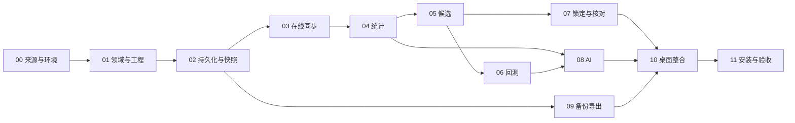

> 历史快照：已被2026年11月2日B/S方案取代，不作为当前开发基线。

# 大吉大利 福彩分析软件实施计划

版本：V1.0 设计评审稿  
日期：2026年11月1日  
依据：[大吉大利详细设计方案](2026-11-01-dajidali-design.md)  
当前状态：设计与计划已编制，尚未创建应用工程、采集历史数据或调用付费AI。

## 一、实施目标与交付口径

**目标：交付可安装、可离线分析、可在线更新、可核对AI依据的Windows个人版。** 以双色球近五年数据为范围，贯通初始化、统计、候选、随机对照、AI、锁定、开奖核对、备份恢复。

**架构：** Flutter应用负责界面和编排，纯Dart包承载领域、统计、候选与回测；Drift/SQLite保存数据及修订；系统凭证存储保存密钥。首版直连数据源，未来数据服务通过适配器接入。重型计算通过isolate执行。

**技术准备：** 开始开发时锁定Flutter/Dart、依赖包、Windows构建工具和安装器版本，提交锁文件和环境清单。所有命令在项目根目录运行；本计划中的目录均为拟创建文件，当前实际交付仅为文档。

**实施约束：** 每项任务完成用例、测试、错误反馈和文档后再进入下一项。先验证真实数据源，再承诺在线交付。模拟源和模拟AI用于开发与回归，真实来源、真实模型和目标电脑验收另列证据。软件交付不要求策略战胜随机。

## 二、工作量与里程碑

### 2.1 基准资源与周期

以1名熟悉Flutter/Dart的开发人员全职投入，测试人员平均0.3人参与，产品/设计按需参与估算：开发43人日，测试10—15人日，产品与设计4—6人日，合计57—64人日。考虑10%—15%缓冲，建议排期 **9—10周**。这是工程估算，依赖数据授权、环境准备和反馈效率，非合同工期承诺。

具备2名开发及独立测试资源时，可将UI、适配器等明确边界任务安排在接口冻结后并行，目标6—7周；数据准入、规则核验和完整验收仍按依赖顺序执行。

| 阶段 | 建议时间 | 交付与出口 |
|---|---|---|
| G0 可实施性确认 | 第1周 | 在线来源覆盖和许可报告、工具链及SQLite读写验证、AI可用性验证 |
| G1 数据底座 | 第2—3周 | 安装前开发版、数据库修订、完整性清单、可恢复同步及开奖数据页 |
| G2 本地分析闭环 | 第4—6周 | 统计图表、两种候选方法、历史回测和B0/B1对照 |
| G3 AI与前瞻记录 | 第6—7周 | AI资料包和校验、策略预览、锁定、自动核对和修订结算 |
| G4 桌面交付 | 第8—9周 | 导出备份、目标电脑完整测试、安装包和使用说明 |
| 缓冲 | 第10周 | 只处理缺陷、来源变动和验收遗留，不默认增加功能 |

阶段验收是完成证据检查，不是反复请求常规开发许可。数据许可缺失、真实来源不可用或涉及超范围功能时，将具体差距提交决策；已能独立完成的设计或本地验证继续推进。

### 2.2 关键依赖



## 三、目录与责任边界

```text
福彩分析/
  apps/dajidali/                    Flutter Windows应用；未来增加Android平台
    lib/app/                       路由、依赖注入、全局任务和错误反馈
    lib/features/overview/         总览
    lib/features/draws/            开奖数据、来源和质量详情
    lib/features/analysis/         统计图表
    lib/features/strategies/       策略参数与候选
    lib/features/backtests/        回测配置、进度和报告
    lib/features/ai/               AI分析和证据预览
    lib/features/candidates/       锁定记录与核对
    lib/features/settings/         数据源、AI、备份和版本
    integration_test/              完整流程与平台验收入口
  packages/dajidali_domain/         类型、规则、契约和错误码，纯Dart
  packages/dajidali_engine/         统计、随机、生成、回测和奖级匹配，纯Dart
  packages/dajidali_data/           SQLite、来源适配、修订、快照和仓储
  packages/dajidali_ai/             Provider、资料包、输出校验及费用限制
  packages/dajidali_platform/       凭证、文件、系统时间与桌面集成
  contracts/v1/                    JSON Schema、协议样例、兼容规则
  fixtures/                        人工小样本、边界样例、来源脱敏录制
  tooling/                         检查、打包和验收脚本
  docs/decisions/                  技术决策与来源准入报告
  docs/acceptance/                 真实源、模型、目标电脑验收记录
  docs/user-guide/                 安装、配置、分析和恢复说明
  docs/superpowers/specs/           本详细设计
  docs/superpowers/plans/           本实施计划
```

工程组织在任务01确定Dart workspace及依赖布局。领域包不依赖UI、数据库或平台包；引擎只依赖领域及固定算法所需基础库。平台包提供接口实现，禁止将Windows系统调用散落在共享核心。

## 四、任务分解

每项任务按“明确接口和样例 → 编写会暴露缺陷的测试 → 运行并确认缺口 → 最小实现 → 本任务验证 → 保存代码与证据”推进。测试文件名与用例名称固定在下面；实施者将Given/When/Then转换为同名可执行测试，不另行发明验收口径。完成代码步骤后只提交该任务涉及的文件，已有工作区变更先检查并保护。

### 任务00 数据源、AI与构建环境准入

**工期：4人日；前置：设计基线明确。**

文件：

- 创建 `docs/decisions/0001-platform-and-dependencies.md`。
- 创建 `docs/decisions/0002-data-source-qualification.md`。
- 创建 `docs/decisions/0003-ai-provider-qualification.md`。
- 创建 `fixtures/sources/manifest.json`，仅保存获准的脱敏样例及哈希。
- 创建 `docs/acceptance/g0-feasibility.md`。

接口产物：`SourceCapabilitiesV1`至少包含games、historical_query_mode、earliest_verified_date、latest_query、revision_support、rate_limits、storage_permission、display_permission；未知能力明确为unknown。输出被选中的主来源及补漏/核验来源，不提前承诺必须选用某供应商。

实施步骤：

1. 检查现有工作区、Flutter/Dart、Visual Studio C++工具链、Windows SDK和磁盘可用空间，保存版本与安装缺口；不覆盖用户已有配置。
2. 复核官方规则、期号清单与休市依据，确认2026规则边界和福运奖。保存公告引用，旧规则未核实前禁止历史奖金完整验收。
3. 按五年最早/中间/最近年份测试数据源，抽取连续区间及跨年样例；记录实际HTTP状态、字段、限流和覆盖。不得在日志中输出凭证。
4. 验证保存、展示、个人使用及后续分发的条款范围；计算完整初始化预计请求数，询问供应商的部分只形成待解决事项，不擅自发送消息。
5. 获得凭证后验证一个AI模型的最小结构化响应与用量信息；凭证未提供时标为未通过，不用模拟响应代替。
6. 在临时验证工程中完成Windows的SQLite事务、备份、凭证读写和release构建；验证Android目标可编译共享核心。验证工程隔离，主产品代码在后续任务创建。

验收样例：

```yaml
case: five_year_coverage_cannot_be_inferred_from_latest_100
given: 来源只返回最近100期且无更早历史能力
when: 评价五年在线初始化准入
then: coverage_pass=false；记录真实最早日期；不得显示五年完整
case: g0_unavailable_secret_is_not_a_pass
given: 没有可用AI凭证
when: 运行AI准入检查
then: live_ai_status=not_tested；保留本地开发能力
```

出口：G0报告清楚区分通过、失败、未验证；五年在线来源未通过则不把依赖该能力的阶段标为完成。

### 任务01 领域契约与最小桌面工程

**工期：3人日；前置：任务00平台路线确认。**

文件：

- 创建 `apps/dajidali/pubspec.yaml`、`lib/app/app.dart`、`lib/app/router.dart`、`lib/app/task_center.dart`。
- 创建 `packages/dajidali_domain/lib/src/draw.dart`、`rule.dart`、`snapshot.dart`、`strategy.dart`、`errors.dart`、`repositories.dart`。
- 创建 `contracts/v1/source-capabilities.schema.json`、`draw-revision.schema.json`、`strategy-config.schema.json`。
- 测试 `packages/dajidali_domain/test/draw_validation_test.dart`、`rule_version_test.dart`；`apps/dajidali/test/app_shell_test.dart`。

消费：任务00确定的平台、规则证据、数据能力。产出：`DrawRevisionV1`、`DatasetSnapshotV1`、`StrategyConfigV1`，以及仓储和来源契约，字段与设计第六/十一章一致。

实施步骤：

1. 先写号码、期号、版本边界和错误码的领域测试；确认现有空工程无法满足，再定义不可变对象和显式校验结果。
2. 建立应用和包依赖，锁定工具链和依赖；共享核心禁止导入Flutter、sqlite和Windows实现。
3. 建立八页路由与任务中心，页面先展示真实空状态。统一全局数据状态、任务进度和可读错误。
4. 固定契约Schema、合法/非法样例和版本兼容策略；以相同样例验证各包序列化。

```yaml
case: ssq_rejects_duplicate_red
given: red=[1,1,3,4,5,6]；blue=16
when: 校验ssq号码
then: 返回INVALID_DRAW且明确重复号码
case: fc3d_preserves_position
given: game=fc3d；digits="007"
when: 序列化后再读取
then: digits仍为"007"；位置顺序不变
```

验证：各包 `dart test`，应用 `flutter analyze` 和 `flutter test`；开发窗口可打开并展示八页空状态。出口为工程和领域契约可评审，不计作业务交付完成。

### 任务02 SQLite、修订、快照与迁移

**工期：4人日；前置：任务01。**

文件：

- 创建 `packages/dajidali_data/lib/src/database/app_database.dart`、`tables.dart`、`migrations.dart`。
- 创建 `repositories/draw_repository.dart`、`snapshot_repository.dart`、`observation_repository.dart`。
- 创建 `fixtures/draws/ssq-small.json`、`fixtures/draws/ssq-correction.json`。
- 测试 `packages/dajidali_data/test/revision_test.dart`、`snapshot_test.dart`、`migration_test.dart`。

消费：领域实体、规则和仓储接口。产出：`DrawRepository.createSnapshot`、追加来源观察、接受修订、读取当前记录；按设计第六章建立表和唯一约束。

实施步骤：

1. 先写重复导入、事务中断、并发版本不匹配、旧快照稳定性测试。
2. 实现原始观察、修订、当前指针和证据关系；号码与附属字段变化区分修订原因。
3. 规范化JSON并计算快照哈希，成员引用确切修订；奖金NULL、日期精度与争议状态完整保存。
4. 实现事务与单写入口、索引、结构迁移和迁移前备份接口；异常回滚并保留当前可用库。

```yaml
case: old_snapshot_survives_correction
given: 快照A引用某期revision=1
when: 官方更正产生revision=2且成为当前记录
then: 新快照B引用2；A仍引用1；两者哈希不同
case: identical_observation_is_idempotent
given: 已导入一个source和payload_hash
when: 重复导入相同响应
then: 当前记录不变；不创建重复修订
```

验证：数据库测试全部通过；在Windows原生数据库上完成一次写入、重启读取和中断恢复，不只运行内存数据库测试。

### 任务03 在线采集、缺期补漏和开奖数据页

**工期：4人日；前置：任务02及真实来源准入。**

文件：

- 创建 `packages/dajidali_data/lib/src/sources/draw_source.dart`、`qualified_source_adapter.dart`、`source_registry.dart`。
- 创建 `sync/sync_service.dart`、`sync_scheduler.dart`、`coverage_validator.dart`、`revision_reconciler.dart`。
- 创建 `apps/dajidali/lib/features/draws/draws_page.dart`、`draw_detail.dart`、`coverage_panel.dart`。
- 测试 `packages/dajidali_data/test/source_contract_test.dart`、`sync_resume_test.dart`、`coverage_test.dart`。

消费：来源能力、仓储与日历证据。产出：标准化观察、完整性清单、同步任务状态、修订事件和开奖数据页面。适配器文件内部标明实际供应商；供应商切换通过registry完成。

实施步骤：

1. 用脱敏录制响应建立字段契约测试，覆盖HTTP200业务错误、403、429、超时、JSON损坏、前导零和缺奖金。
2. 实现按日期/分页能力初始化、检查点续传、限流和退避；只在事务提交后推进游标。
3. 实现最近30期复核与每30天历史滚动复核队列；仅最新期号不变时也能发现更正。
4. 建立预期期号清单与缺失解释，展示来源、核验、争议和修订时间线；提供补漏和恢复任务入口。
5. 用真实源执行首次五年范围获取，保存覆盖报告及脱敏日志；实际缺口保持可见，不能用样例数据填充。

```yaml
case: resume_does_not_skip_uncommitted_page
given: 第2页事务提交前进程中断
when: 重新启动同步
then: 从第2页恢复；第1页不重复增修订；第2页无丢失
case: unchanged_latest_issue_still_accepts_old_correction
given: 最新期号不变；一条旧记录被源更正
when: 历史复核经过该期
then: 产生新修订和事件；相关已存结果标为旧版本
```

出口G1：在线历史获取、缺期解释、手动刷新、重启续传可用。五年完整与官方核对比例分别展示。

### 任务04 基础统计与分析图表

**工期：3人日；前置：任务03数据清单和快照。**

文件：

- 创建 `packages/dajidali_engine/lib/src/statistics/frequency.dart`、`omission.dart`、`structure.dart`、`analysis_engine.dart`。
- 创建 `apps/dajidali/lib/features/analysis/analysis_page.dart`、`metric_chart.dart`、`metric_detail.dart`。
- 创建 `contracts/v1/analysis-evidence.schema.json`。
- 测试 `packages/dajidali_engine/test/statistics_test.dart`、`omission_boundary_test.dart`。

消费：不可变数据快照。产出：`AnalysisEngine.compute`与带fact_id的事实集；公式严格按设计第七章。

实施步骤：

1. 人工构造10期和30期样例并手算次数、和值、跨度与截断遗漏，先形成独立期望值。
2. 实现统计及窗口不足、缺期、未知的传播；每个事实附单位、样本数、截止期与公式版本。
3. 实现多窗口对比和明细下钻，图表从事实集读取，使用版本化缓存。
4. 将计算放入isolate并测量目标机耗时，记录统计结果与界面显示一致性。

```yaml
case: red_frequency_uses_draw_denominator
given: 10期合法双色球记录
when: 求33个红球的出现期频率之和
then: 总和为6；蓝球对应总和为1
case: absent_number_is_censored
given: 某号码在窗口30期内从未出现
when: 读取当前遗漏
then: 显示至少30期；不声称完整历史遗漏恰为30
```

验证：引擎测试及图表Widget测试；人工核算附件、快照哈希和计算耗时入验收目录。

### 任务05 随机、频率策略与候选生成

**工期：3人日；前置：任务04。**

文件：

- 创建 `packages/dajidali_engine/lib/src/random/sha256_counter.dart`、`uniform_sampler.dart`。
- 创建 `strategies/uniform_strategy.dart`、`frequency_strategy.dart`、`constraint_validator.dart`、`candidate_engine.dart`。
- 创建 `apps/dajidali/lib/features/strategies/strategy_page.dart`、`candidate_preview.dart`。
- 创建 `fixtures/golden/rng-v1.json`、`fixtures/golden/candidates-v1.json`。
- 测试 `packages/dajidali_engine/test/rng_test.dart`、`candidate_engine_test.dart`、`constraints_test.dart`。

消费：快照、策略白名单、固定种子。产出：`CandidateEngine.generate`；输出组合、实际尝试数、完整/不足状态与参数溯源。

实施步骤：

1. 按设计定义域隔离、计数器编码、字节消费和无偏整数采样，生成经过独立核对的黄金样例。
2. 实现S0无放回抽样和整组去重；完成属性检查及分布合理性检查，随机分布检验不替代算法审查。
3. 实现S1公式、固定浮点运算顺序、参数白名单、结构条件和100,000次上限。
4. 连接策略参数界面，展示方法、约束、样本、未验证状态和候选生成依据。

```yaml
case: lambda_zero_matches_uniform_weights
given: S1的lambda=0；任意历史频率
when: 计算red_w和blue_w
then: 分别为1/33与1/16；不受历史次数影响
case: impossible_constraints_stop
given: 固定红球同时在排除列表
when: 请求生成5组
then: 立即返回具体冲突；不进入无限循环
case: fixed_seed_is_reproducible
given: 相同快照、版本、参数、种子与K
when: 在两次进程中生成
then: 组合与顺序完全一致；结果与黄金样例一致
```

出口：两种方法、参数预览、合法候选、失败反馈与复现证据齐全；无“高概率”标签。

### 任务06 时间顺序回测与随机对照

**工期：5人日；前置：任务05。**

文件：

- 创建 `packages/dajidali_engine/lib/src/backtest/experiment_plan.dart`、`walk_forward.dart`、`baseline_runner.dart`、`metric_aggregator.dart`、`block_bootstrap.dart`。
- 创建 `packages/dajidali_data/lib/src/repositories/experiment_repository.dart`。
- 创建 `apps/dajidali/lib/features/backtests/backtest_page.dart`、`backtest_report.dart`。
- 创建 `contracts/v1/experiment-plan.schema.json`、`backtest-report.schema.json`。
- 测试 `packages/dajidali_engine/test/no_future_leakage_test.dart`、`baseline_parity_test.dart`、`experiment_freeze_test.dart`、`bootstrap_test.dart`。

消费：冻结策略、快照、相同K及条件。产出：`BacktestEngine.run`、逐期结果、B0/B1对照、区间与全量尝试注册表。

实施步骤：

1. 先做泄漏变形测试：修改t期和所有未来开奖号码，t期生成结果必须不变；修改t前输入则允许变化。
2. 实现60/20/20时间划分、热身、缺口排除、12套搜索上限、参数冻结和封存只开一次的记录。
3. 实现每基线200条轨迹、逐期同注数对照及种子域隔离；完成取消和检查点恢复。
4. 实现预注册主指标、次指标、按期差值与移动块bootstrap。用人工小矩阵核对均值与重采样维度，避免将注或轨迹当成独立开奖期。
5. 页面展示计划预览、进度、排除原因、所有尝试和完整报告。跑全规模基准，测量CPU、峰值内存、全生命周期时间。

```yaml
case: future_mutation_does_not_change_prediction
given: 截至t-1的数据完全一致
when: 仅改变t及之后的数据后重新执行
then: t期候选哈希完全一致
case: random_comparator_has_equal_budget
given: K=5且策略有奇偶结构条件
when: 运行B0和B1
then: 每条轨迹每期均5组；B1使用同条件；B0明确无条件
case: reopened_holdout_is_not_blind
given: 已读取封存报告并调整策略
when: 再次运行原封存区间
then: 标为已使用数据上的探索结果
```

出口G2：能从真实数据快照运行完整回测和对照；未发现优势的报告正常生成。取消与失败不混入已完成总体成绩。

### 任务07 候选锁定、规则和修订结算

**工期：3人日；前置：任务05及数据修订事件；与任务06无代码互改依赖。**

文件：

- 创建 `packages/dajidali_engine/lib/src/settlement/prize_matcher.dart`、`rule_resolver.dart`。
- 创建 `packages/dajidali_data/lib/src/ledger/candidate_ledger.dart`、`settlement_service.dart`。
- 创建 `apps/dajidali/lib/features/candidates/candidate_records_page.dart`、`settlement_detail.dart`。
- 测试 `packages/dajidali_data/test/locking_test.dart`、`settlement_revision_test.dart`；`packages/dajidali_engine/test/prize_rule_boundary_test.dart`。

消费：草稿、日历截止证据、期号规则和有效开奖修订。产出：`CandidateLedger.lock`、`SettlementService.reconcile`及不可改写批次。

实施步骤：

1. 写锁定截止、未知时间、目标已开奖、快照包含目标、过期草稿版本等拒绝测试。
2. 实现本机锁定哈希、审计事件、只追加备注和每期研究通道首批次规则。
3. 按官方证据建立旧/新规则、特别规定模式及福运奖匹配；奖金未取得传播为未知。
4. 实现幂等结算、冲突暂停、金额后补及历史更正追加结算；回测复用同一奖级匹配器。

```yaml
case: special_mode_three_red_only
given: r=3、b=false、特别规定已确认启用
when: 按该期规则核对
then: 匹配福运奖；同组合不重复计普通奖
case: unknown_special_mode_does_not_invent_money
given: r=3、b=false；该期特别规定状态未知
when: 进行核对
then: 保存命中数；奖级金额为待确认
case: correction_adds_settlement_revision
given: 某批次已按开奖revision=1结算
when: revision=2核验后生效
then: 追加结算并关联旧结果；原候选及旧结算不覆盖
```

验证：本地锁定标识准确，不能导出“第三方时间认证”字样；模拟多个批次时聚合不挑最好成绩。

### 任务08 AI资料包、连接与受限建议

**工期：4人日；前置：任务04事实集、任务06回测报告；真实AI凭证可用。**

文件：

- 创建 `packages/dajidali_ai/lib/src/provider.dart`、`qualified_provider.dart`、`evidence_builder.dart`、`report_validator.dart`、`usage_limiter.dart`。
- 创建 `packages/dajidali_platform/lib/src/secret_store.dart`、`windows_secret_store.dart`。
- 创建 `contracts/v1/ai-report.schema.json`、`fixtures/ai/valid-report.json`、`invalid-reports.json`。
- 创建 `apps/dajidali/lib/features/ai/ai_page.dart`、`evidence_preview.dart`、`proposal_diff.dart`。
- 测试 `packages/dajidali_ai/test/evidence_test.dart`、`report_validator_test.dart`、`usage_limiter_test.dart`。

消费：AnalysisEvidenceV1、冻结策略白名单和已有回测证据。产出：AiReportV1、Provider实现、校验状态与当次原始响应引用。

实施步骤：

1. 先用恶意和错误响应测试未知fact_id、伪造数值、越界参数、错误快照、任意代码/URL字段。
2. 实现资料预览、模型配置和系统凭证存储；请求日志及源响应统一脱敏。
3. 实现一次主调用/一次格式纠正、60秒超时、次数预算及金额未知状态；超时不盲目重试。
4. 报告由事实引用与本地模板填入数字，策略建议展示参数差异，用户应用后交本地引擎执行。
5. 运行一次真实AI端到端，保存脱敏请求、响应、校验、用量及界面证据；断网、限流、取消和失效凭证分别检查。

```yaml
case: unknown_fact_disables_apply
given: AI返回不存在的fact_id和lambda=0.9
when: 校验报告
then: 报告不可应用；显示引用错误和参数越界；不运行策略
case: timeout_does_not_trigger_unbounded_retry
given: 已发送请求但60秒未返回
when: 超时处理
then: 状态为结果未知/可手动重试；不自动重复主调用
case: ai_failure_preserves_local_analysis
given: 本地统计与回测已完成
when: AI连接失败
then: 本地结果、候选草稿和版本仍可查看与导出
```

出口G3：真实模型可用、数字依据可核对、策略应用受约束、费用与失败状态透明；前瞻记录闭环可运行。

### 任务09 报告导出与备份恢复

**工期：3人日；前置：任务02；完整报告需任务06/07/08。**

文件：

- 创建 `packages/dajidali_data/lib/src/backup/backup_service.dart`、`backup_manifest.dart`、`restore_validator.dart`。
- 创建 `packages/dajidali_platform/lib/src/file_access.dart`。
- 创建 `apps/dajidali/lib/features/settings/backup_panel.dart`、`lib/app/export_service.dart`。
- 测试 `packages/dajidali_data/test/backup_roundtrip_test.dart`、`restore_security_test.dart`；`apps/dajidali/test/export_test.dart`。

消费：数据库、被引用附件、报告和版本清单。产出：CSV/JSON/自包含HTML；一致性备份包和恢复预览。

实施步骤：

1. 写运行中WAL备份往返、损坏哈希、路径穿越、新版结构、磁盘不足、密钥排除测试。
2. 实现一致性快照和附件清单，导出只含允许数据；HTML内容转义，CSV文本防公式注入。
3. 实现临时恢复、完整性检查、影响预览、当前库备份与替换失败恢复；重新配置密钥的提示明确。
4. 用包含锁定、AI和修订结算的真实本地记录恢复到隔离目录，逐项核对哈希与结果。

```yaml
case: backup_has_no_secrets
given: 数据源和AI凭证已配置
when: 创建备份并检查内容
then: 无密钥/鉴权头/携密钥URL；仅有凭证引用或重新配置说明
case: restore_failure_preserves_current
given: 包内数据库哈希不匹配
when: 尝试恢复
then: 拒绝替换；当前数据及锁定记录保持可用
```

出口：备份可读回，跨进程恢复后仍能复算；未完整返奖结果不会导出成完整收益结论。

### 任务10 桌面整合与操作体验

**工期：3人日；前置：任务03—09。**

文件：

- 完善 `apps/dajidali/lib/features/overview/overview_page.dart`、`settings/settings_page.dart`。
- 完善 `apps/dajidali/lib/app/task_center.dart`、`global_data_status.dart`、`error_presenter.dart`。
- 创建 `apps/dajidali/integration_test/user_journey_test.dart`、`offline_test.dart`、`stale_result_test.dart`。
- 创建 `docs/user-guide/quick-start.md`、`data-and-ai-settings.md`、`backup-and-recovery.md`。

消费：各模块稳定接口。产出：完整桌面流程、统一任务反馈和用户指南。

实施步骤：

1. 把各页面输入、全局截至期、任务快照和错误状态统一；旧任务完成后不得覆盖新筛选结果。
2. 连通首次使用、日常分析与开奖核对流程，主操作可键盘触达，AI栏在小窗口折叠。
3. 检查1280×720、1440×900、系统125%/150%缩放、中文路径及长错误文本。
4. 完成无数据、数据不完整、断网、AI不可用、生成无解、任务中断和待重算反馈；为每种状态提供明确下一动作。

```yaml
case: old_ai_result_does_not_replace_new_context
given: 快照A的AI请求仍在执行；用户已切到快照B
when: A的响应返回
then: 保存为A的历史结果；B页面不显示为当前分析
case: offline_workflow_uses_saved_snapshot
given: 数据、策略和回测已本地保存
when: 断网重启
then: 可查询、统计、生成和回测；显示实际截止期与联网失败状态
```

验证：完整用户旅程测试、键盘与缩放人工检查、脱敏日志核查。不能只以页面可打开判定功能完成。

### 任务11 目标电脑、安装包与最终验收

**工期：4人日；前置：任务10及真实源/AI证据。**

文件：

- 创建 `tooling/verify.ps1`、`tooling/package_windows.ps1`。
- 创建 `docs/acceptance/release-checklist.md`、`target-machine-baseline.md`、`end-to-end-report.md`。
- 创建安装配置、版本说明、第三方许可清单及构建清单。
- 创建 `apps/dajidali/integration_test/release_journey_test.dart`。

消费：完整应用、锁定依赖和准入报告。产出：Windows安装包、校验值、发布说明、验收证据和遗留清单。

实施步骤：

1. 在干净Windows 11 x64普通用户环境安装release包，验证无需开发SDK即可启动；Windows 10 x64按兼容范围另测并记录系统版本。
2. 从配置、五年采集、重启、统计、AI、回测、候选锁定到核对和备份恢复运行完整流程。真实未开奖事件无法加速时，用隔离测试日历验证机制；真实前瞻长期表现保持独立状态。
3. 按设计性能预算测量启动、查询、统计、回测、取消、峰值内存和采集总耗时；记录数据快照、硬件、版本和参数。
4. 验证升级迁移、失败回滚、卸载数据保留行为和损坏备份；安装数据与用户数据分离。
5. 汇总严重缺陷、已知限制和真实服务成本信息，按冻结范围验收；不以演示录像替代原始日志与结果文件。

```yaml
case: release_runs_without_development_environment
given: 干净Windows普通用户环境未安装Flutter
when: 安装并启动发布包
then: 可打开且数据库和基础分析正常；缺外部凭证只影响联网功能
case: end_to_end_is_not_replaced_by_mock_success
given: 模拟源与模拟AI回归全部通过
when: 真实数据源或模型尚未验证
then: 模块测试通过；真实集成验收仍为未完成
```

出口G4：安装包和完整流程证据交付，严重缺陷为0；未通过项目列出原因、影响与后续责任，不标记为已完成。

## 五、验证命令与证据管理

根目录的 `tooling/verify.ps1` 在任务11汇总此前同一套检查。构建工程后按实际包结构执行以下命令，最终命令以锁定SDK验证结果为准：

```powershell
flutter analyze
flutter test
flutter test integration_test -d windows
flutter build windows --release
```

上述Flutter命令在 `apps/dajidali` 执行；各共享包在自身目录执行 `dart analyze`、`dart test`，涉及Flutter平台的包使用 `flutter test`。脚本通过明确工作目录调用，失败即返回非零，不用末尾成功掩盖前面的失败。真实源和真实AI测试使用显式开关及系统凭证，默认离线回归不消耗调用额度。

证据按日期/版本归档：环境清单、快照清单、来源覆盖报告、脱敏错误日志、性能原始数据、回测报告、安装包SHA-256、目标机截图、备份恢复对照。测试数据、正式用户数据和缓存目录分开，禁止以清理测试为由递归删除用户数据。

## 六、验收矩阵与完成标准

| 需求 | 实施任务 | 必备证据 | 交付门槛 |
|---|---|---|---|
| R01 Windows及Android预留 | 00/01/11 | Windows安装结果、核心依赖检查、Android核心编译 | 两端核心无平台耦合；首版Windows实际可用 |
| R02 五年在线数据 | 00/02/03 | 覆盖清单、休市依据、缺期和冲突报告 | 无未说明缺口；核验级别与完整性分别展示 |
| R03 自动更新及更正 | 03/07 | 中断、重复、更正和补漏测试 | 新增与历史更正均生效且幂等 |
| R04 数学统计 | 04 | 人工样例、公式版本、图表对照 | 数字一致，截断与未知处理正确 |
| R05 AI参与分析 | 08/10/11 | 真实响应、引用校验、异常和费用限制 | 有事实依据；非法建议不可执行 |
| R06 研究候选 | 05 | 黄金样例、合法性及无解测试 | 同版本可复现；批内无重复 |
| R07 回测与前瞻 | 06/07 | 防泄漏、双基线、锁定及修订结算 | 全尝试可查；本机锁定边界披露 |
| R08 离线及恢复 | 09/10/11 | 断网旅程、往返恢复、release安装 | 无凭证泄露；恢复后记录一致 |

模块完成定义：接口与Schema稳定、核心测试通过、失败行为可见、文档更新、所属文件审阅完成。阶段完成定义：该阶段所有模块已集成并跑通对应用户流程。产品完成定义：真实服务与目标电脑验收完成、安装交付和资料齐全。三类完成不得互相替代。

## 七、成本与变更控制

### 7.1 成本结构

工程费用按开发43人日、测试10—15人日、产品/设计4—6人日乘以实际报价估算，再计10%—15%风险准备；不把示例人日换算为供应商正式报价。个人自研的现金支出主要来自数据接口、AI、可能的签名证书及后续云服务。

数据接口预算公式：初始化总调用量＋每月开奖检查＋最近30期复核＋全量复核，分别按已选供应商单价和额度核算。AI预算按输入/输出实际用量与模型价格核算，未知费率保持未知。V1.0无需持续运行云主机；后续服务成本另行立项。

### 7.2 变更入口

新增彩种、提高候选数量上限、更换核心技术、引入云账号/支付/共享服务密钥、个人记录云同步及额外模型训练，形成单独需求和影响评估。来源适配、已定义边界修复及普通界面优化在本版范围内处理，保存对应决策和版本。

### 7.3 不通过时的处置

- 五年来源不通过：更换有许可来源；未取得真实五年覆盖前，在线目标不验收。
- AI未通过：本地闭环可继续开发，AI模块保持未完成；不将固定模板冒充真实模型输出。
- 共享插件不通过：优先替换适配器并保留领域/计算接口；如改变Flutter路线再评估工期。
- 回测没有显示优势：正常交付研究结果和证据；不通过反复调参制造“提升”。
- 目标机性能不达标：根据完整流程日志定位，优化后重测相同基线；组件微基准不替代目标机验收。

## 八、交付清单和后续阶段

V1.0交付包含：源代码及锁定依赖、Windows安装包与校验值、数据库结构和迁移、数据源适配与准入报告、统计/策略/回测核心、AI协议与真实连接证据、锁定与核对记录、CSV/JSON/HTML导出、备份恢复、使用指南、测试和性能报告、第三方许可及已知限制。

V1.0后按需启动：

| 工作包 | 初步估算 | 主要内容 | 前置 |
|---|---|---|---|
| 福彩3D | 1—2周 | 有序三位数据、单选/组选规则、对应统计、对照和页面 | 官方玩法及来源重新核验 |
| 轻量数据服务 | 2—3周 | 持续采集、修订流、凭证管理、监控和公共数据同步 | 数据分发许可及部署环境 |
| Android首版 | 3—5周 | 手机布局、文件/凭证适配、后台同步、通知及真机验证 | 稳定共享核心；平台和插件准入 |
| 外部时间凭据 | 另行估算 | 服务端签收、内容哈希、不可改写签收记录 | 明确前瞻记录的外部证明需求 |

后续工作包不计入V1.0的9—10周基准周期，也不承诺未经验证的代码复用比例。
