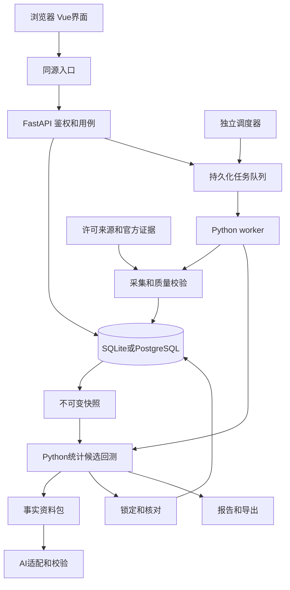
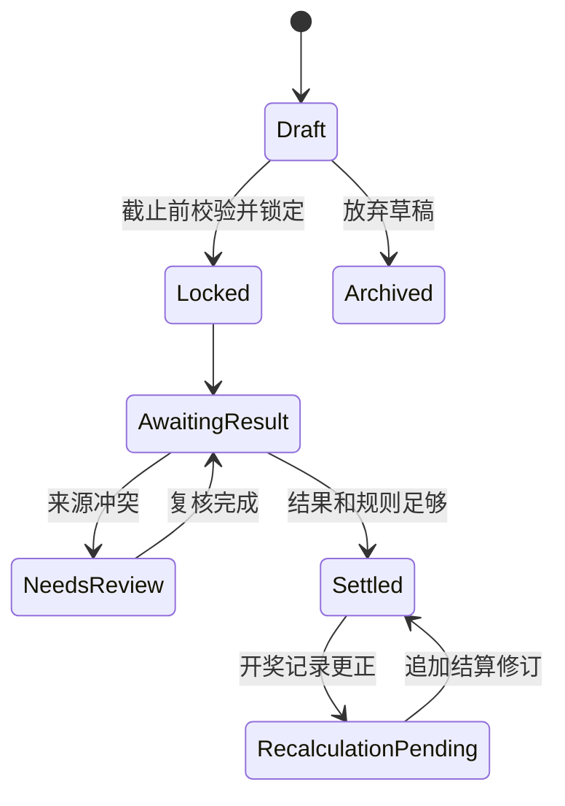

# 大吉大利 Python与浏览器B/S版详细设计方案

文档版本：V1.1 B/S架构修订稿；产品首版仍为V1.0  
修订日期：2026年11月2日  
建设顺序：Python后端与浏览器界面 → 本机及服务器部署 → 移动浏览器适配  
适用范围：个人或小团队使用的双色球分析、候选研究和效果核对。

## 一、设计结论与需求基线

“大吉大利”定位为福彩数据与AI辅助分析工作台，完成“在线获取数据—统计分析—AI提出研究建议—引擎生成候选—历史回测—开奖前锁定—开奖后核对”的闭环。首版采用 **Python FastAPI后端＋Vue 3/TypeScript浏览器前端＋独立Python计算引擎＋SQLAlchemy/Alembic数据层**。本机使用SQLite，服务器使用PostgreSQL，浏览器经HTTP API访问，同一套业务支持两种部署。

本方案沿用[原分享方案](https://chatgpt.com/share/6ae75038-3960-83e9-be0a-3872e4a693ef)的分析能力，以用户2026年11月2日明确的“Python＋浏览器，可部署B/S架构”为当前建设基线。名称为“大吉大利”，此前桌面安装版路线已归档。本文和实施计划为拟建设要求，尚未开始应用开发。

### 1.1 需求及落点

| 编号 | 需求 | 首版设计落点 | 验收依据 |
|---|---|---|---|
| R01 | Python＋浏览器，可部署B/S | FastAPI、Vue、Python计算及两种部署配置 | 本机运行、服务器部署和浏览器完整流程分别通过 |
| R02 | 近五年历史数据在线获取 | 历史初始化任务、来源清单、完整性清单 | 日期边界、有效期数、缺期逐项解释 |
| R03 | 在线更新最新结果 | 启动同步、运行期轮询、补漏、历史修订 | 新增及更正均可同步，重启可续传 |
| R04 | 数学分析 | 30/100/300期及全范围统计、公式版本 | 人工小样本核算与固定样例一致 |
| R05 | 结合AI进行研判 | 事实资料包、结构化建议、受限策略参数 | 数字可追溯，非法建议拒绝执行 |
| R06 | 生成未来候选 | 均匀随机、平滑频率两种方法及结构条件 | 合法性、去重、种子复现、参数边界 |
| R07 | 判断方法是否有价值 | 时间顺序回测、双随机对照、真实前瞻记录 | 不泄漏未来信息，失败与排除均留痕 |
| R08 | 持续运行、授权与恢复 | 后端任务、登录与权限、备份恢复 | 浏览器关闭任务继续；无越权；密钥不下发 |

### 1.2 建设假设

1. 首版面向个人或小团队、单组织部署，提供管理员与分析员角色。客户端为当前稳定版Edge/Chrome；后端验证Windows本机及Linux服务器，服务器初始验收规模为5名同时在线用户、重回测同时1个。
2. 首版只实现双色球单式候选，每组6红1蓝；福彩3D保留类型和适配接口，放入产品V1.1。
3. 来源和AI凭证由后端管理员配置保管，浏览器只读取掩码与连接状态。个人使用、团队展示和对外分发的许可分别核验。
4. 五年范围为初始化截止日向前五个日历年至已公布的最新一期；以2026年11月2日初始化为例，起点为2021年11月2日。实际截止期号由来源确认。
5. 采集、AI和回测由后端worker执行，调度独立运行。浏览器关闭不停止任务；后端或主机停止后按检查点恢复。持续采集依赖后端主机持续运行。
6. 本机与服务器均有账号、会话和对象归属校验。本机默认仅监听127.0.0.1；服务器由同源反向代理及HTTPS提供入口，数据库不向浏览器直接开放。

### 1.3 分析边界

在公平且各期独立的开奖假设下，历史频次、遗漏与AI文字解释不能证明某组号码更容易中奖。软件提供“研究候选”和证据对照，不将抽样权重标为中奖概率。按双色球6/33与1/16规则，一组合法单式组合命中一等奖的理论概率为 `1 / (C(33,6) × 16) = 1 / 17,721,088`，这是组合推导，不是软件实测效果。[官方号码规则](https://www.scflcp.com.cn/yxgz/823145252.jhtml)

首版业务范围不含线上购票、代购、合买、充值、资金账户及出票。该范围依据禁止擅自互联网售彩的现行公开管理文件确定；后续商业分发需单独评估数据许可、展示内容与运营要求。[彩票管理条例实施细则](https://jdjc.mof.gov.cn/fgzd/202204/t20220422_3805017.htm)

## 二、版本范围与建设路径

| 产品版本 | 交付范围 | 进入条件 |
|---|---|---|
| V1.0 B/S版 | 双色球、五年数据、统计、两种候选方法、回测、一个AI、锁定核对、导出备份、登录授权；本机及服务器部署 | 来源许可明确；两种数据库和部署完整验收 |
| V1.1 分析增强 | 福彩3D、统计视图和报告增强；经证据验证的简单学习方法 | 首版稳定，新增规则及样例齐全 |
| V1.2 运行扩展 | 更多worker、监控告警和外部数据订阅 | 已测量瓶颈，新增用途许可满足 |
| V2.0 移动访问增强 | 手机浏览器布局、简报、候选及核对；按需评估PWA | 响应式和HTTPS真机验收通过 |

Python为首版正式业务及计算语言。深度训练、多模型自动博弈、自动追投和多租户计费不列入首版，原生App另行立项。文档V1.1表示本次架构修订，不代表软件版本已经交付。

## 三、技术方案与架构

### 3.1 技术选型

| 层次 | 建议选择 | 职责及边界 |
|---|---|---|
| 前端 | Vue 3、TypeScript、Vite、ECharts | 页面、图表、参数和任务状态；不复制正式算法 |
| API | Python、FastAPI、Pydantic、Uvicorn | 入参、会话、授权、业务编排和OpenAPI |
| 计算 | 独立Python模块，NumPy/Pandas辅助 | 统计、候选、回测和核对，不自行访问网络 |
| 数据 | SQLAlchemy、Alembic | ORM、迁移和受控事务；两类数据库分别验证 |
| 数据库 | SQLite本机；PostgreSQL服务器 | SQLite单worker；PG验证并发领取和隔离 |
| 联网 | HTTPX及来源/AI适配器 | 后端访问、超时、限流和脱敏 |
| 任务 | 数据库持久化队列、独立worker和scheduler | 首版小规模无需Redis；接口支持后续替换队列 |
| 发布 | 预构建静态资源＋Python环境；服务器Docker Compose | 使用者无需Node.js，开发构建时需要 |

G0实测后锁定Python及依赖版本，保存锁文件和构建清单。FastAPI＋Vue为当前基线；团队已有Django能力时可单独评估等价替换，研究工具页面仅作可抛弃原型。[FastAPI](https://fastapi.tiangolo.com/deployment/)、[Vue](https://vuejs.org/guide/introduction.html)、[SQLAlchemy](https://docs.sqlalchemy.org/en/21/intro.html)、[Alembic](https://alembic.sqlalchemy.org/en/latest/)、[ECharts](https://echarts.apache.org/handbook/en/get-started/)

### 3.2 逻辑架构



浏览器只调用API，不直连数据库、供应商和AI。耗时请求持久化后返回job_id，独立worker执行，前端每2秒轮询进度；关闭或刷新网页后凭任务ID恢复查看。FastAPI轻量BackgroundTasks不承担需持久化和恢复的回测/采集队列。[后台任务说明](https://fastapi.tiangolo.com/tutorial/background-tasks/)

### 3.3 模块职责

domain定义不可变Python领域对象；engine负责纯计算；data负责修订、证据、快照与仓储；services编排同步、AI、锁定、核对及导出；jobs管理租约、检查点和调度；security负责认证、归属和密钥；web负责八页界面。共享核心不依赖Web框架，任务进程不把数据库会话传入计算子进程。

### 3.4 部署模式

| 项目 | 本机模式 | 服务器模式 |
|---|---|---|
| 访问 | 127.0.0.1:8000 | 域名或受控内网入口 |
| 运行 | API＋单worker＋单scheduler | 反代＋API＋worker＋单scheduler |
| 数据 | SQLite及本机附件目录 | PostgreSQL及持久化附件卷 |
| 安全 | loopback、会话、Host/Origin与CSRF校验 | HTTPS、登录授权、数据库不公开 |
| 用户端 | 启动后端后打开浏览器，无客户端安装包 | 只需浏览器 |
| 断外网 | 服务仍运行可计算，在线源和AI受影响 | 内网可达服务仍可计算；浏览器失联不能新发请求 |
| 关闭浏览器 | 后台继续，主机/服务须运行 | 后台继续，由服务器维持 |

API扩容不能重复启动调度器。SQLite文件不放网络共享目录、不供多主机写入；迁移PG需数据与并发验收，不只修改连接字符串。[SQLite适配说明](https://docs.sqlalchemy.org/en/20/dialects/sqlite.html)

## 四、页面与操作设计

### 4.1 浏览器布局

采用左侧导航、中央工作区、可折叠右侧AI解释区。按1440×900设计，适配1280×720浏览器视口；缩窄时右栏改为抽屉。红球与蓝球颜色用于球号识别，质量、错误和成功状态同时显示文字与图标。

全局顶部固定展示：当前彩种、截至期号、有效期数、完整性、核验级别、最近同步时间、同步按钮。底部任务栏展示运行、暂停、失败和完成任务，耗时操作可取消。

### 4.2 页面清单

| 页面 | 核心内容与布局 | 主要动作 | 状态与反馈 |
|---|---|---|---|
| 总览 | 最新结果卡、数据质量卡、已锁定批次、近期实验摘要 | 同步、继续任务、进入分析 | 数据未初始化时引导配置；不展示虚构示例为真实结果 |
| 开奖数据 | 期号/日期筛选、号码表、来源详情、修订时间线、缺期列表 | 初始化、补漏、复核、导出 | 冲突行可查各来源；缺失奖金为“未取得” |
| 统计分析 | 窗口筛选；频次、遗漏、和值、奇偶、分区等图表 | 比较窗口、查看明细、发送AI | 每张图显示口径、样本数、截止期和版本 |
| AI分析 | 条件区、事实结果、AI报告及引用；发送资料预览 | 分析、停止、查看依据、预览建议 | 连接失败保留后端已有结果；未经校验建议不可应用 |
| 策略实验 | 策略参数、结构条件、候选表、随机对照入口 | 生成、保存草稿、加入回测、锁定 | 条件无解提示具体条件；不静默放宽约束 |
| 历史回测 | 时间划分、参数冻结记录、任务进度、比较表和逐期结果 | 预览计划、运行、取消、导出 | 探索/封存状态醒目；排除期数及原因可展开 |
| 候选记录 | 草稿、锁定、待开奖、已核对、修订待重算 | 查看原始批次、核对详情、导出 | 锁定后只可追加说明；重算不覆盖旧结算 |
| 设置与任务 | 数据源、AI、费用限制、备份、版本、日志和任务队列 | 测试连接、备份恢复、查看脱敏日志 | 凭证只显示掩码；全局配置仅管理员可改；任务不依赖浏览器保活 |

### 4.3 首次使用流程

1. 管理员初始化账号；浏览器登录后展示用途和联网范围。数据目录由后端部署配置指定，网页不能提交任意服务器路径。
2. 选择数据源并测试连接，显示能力检测结果：历史分页、单期查询、最新查询及限流。
3. 创建五年初始化任务，先预览范围、预计调用量，再执行分批采集。
4. 展示已取得、已核验、缺失、冲突和休市说明；若未完整，允许进入已取得数据分析，明确实际范围。
5. 可选配置AI。预览发送的统计摘要，测试后保存凭证引用；跳过后仍可使用Python统计和回测。
6. 引导完成一次统计、一次策略与随机对照、一次候选草稿保存。

### 4.4 日常分析流程

启动补齐 → 选择窗口 → 查看事实 → AI建议 → 参数预览 → 引擎回测 → 生成研究候选 → 开奖前锁定 → 同步后核对。用户可以从任一步进入；“尚未回测”的策略可保存研究草稿，但不得显示为已验证优势。

### 4.5 一致的状态语义

| 状态 | 对用户的表达 | 行为 |
|---|---|---|
| 数据落后 | 截至某期，尚未确认最新 | 历史研究可继续；目标期锁定校验单独执行 |
| 输入含未解决缺期/冲突 | 当前窗口存在数据问题 | 可看描述性结果；正式回测和前瞻锁定被阻止 |
| 单源结构通过 | 结构校验通过，尚未跨源核对 | 可探索；不进入首版正式比较集合 |
| 跨源一致 | 多来源记录一致，未官方逐期核对 | 可按预设门槛纳入比较，报告披露比例 |
| 官方已核对 | 已附官方证据 | 进入正式比较；仍保留修订能力 |
| AI不可用 | AI分析失败，可重试 | 保留统计、草稿与已生成候选 |
| 数据更新 | 此报告使用旧快照 | 可查看原结果或新建分析，不改写已锁定内容 |

## 五、在线数据获取与质量管理

### 5.1 来源策略

| 来源 | 拟承担用途 | 当前结论 | 接入前必须完成 |
|---|---|---|---|
| 官方开奖公告和历史查询 | 规则及结果核验依据 | 作为权威证据，自动访问方式仍需确认 | 允许方式、频率、覆盖和保存许可 |
| 聚合数据 | 候选历史批量来源 | 分享方案列为候选；11月1日文档抓取返回405，未实测 | 重新核实服务、历史分页、五年覆盖、费用与授权 |
| 接口盒子 | 最新查询、指定期补漏的候选 | 文档列出历史/最新与限流；未进行带凭证调用 | 返回字段映射、早期历史、准确性、修订能力及许可 |
| CSV/JSON导入 | 补充、迁移及恢复 | 首版保留，不能代替正常在线初始化验收 | 编码、模板、校验、来源标记、导入预览 |

供应商文档的“最快更新”等表述不转为本产品时效承诺。接口盒子文档存在期号参数表述不一致的情况，适配器需以实际响应与契约样例确认，不能照抄文档字段。两家接口可能转引同一上游，跨源一致不等于独立核验，更不等于官方核验。[接口盒子文档](https://www.apihz.cn/api/caipiaoshuangseqiu.html)、[聚合数据候选文档](https://www.juhe.cn/docs/api/id/300)

### 5.2 来源准入

来源须通过：五年起点/中间/终点查询、跨年期号、连续一段历史、最新结果延迟、断网恢复、鉴权错误、限流、缺值和异常字段测试。覆盖范围逐期对照独立的预期期开奖清单，禁止用同一个接口返回条目数证明自身完整性。

数据准入报告保存供应商、条款版本、允许用途、是否可长期保存/对外展示、调用额度、样例哈希及实测结果。无可用在线源时，保留离线原型验证能力，在线交付门槛保持未通过。

### 5.3 初始化与更新

初始化固定 `start_date`、`end_date`、来源版本和期号清单修订。按来源分页/日期能力分块；每块事务提交后保存检查点。相同数据重跑不增加重复修订。

运行期默认：启动时增量补齐；有确认日历的预计发布窗口内每5分钟检查一次、最多12次；成功取得当期号码后停止密集查询；失败按5/10/20/40分钟退避并加抖动。以上均为产品初始配置，执行上限取供应商约束与用户配置中更严格者。

每次启动复核最近30期；运行期间每日复核最近30期，历史全量每30天滚动完成一次。来源若提供修订游标，优先按游标同步。只支持单期查询时，按限流队列分批遍历清单，并明确“某日前历史尚未完成复核”。发现冲突后暂停该期正式结算。

### 5.4 完整性与核验

完整性清单来源为官方开奖日历、休市公告与已确认期号目录的组合，分别记录依据。期号保存为字符串，排序使用规范化的年份与序号；不得把相邻日期都当成开奖日，也不得简单对期号加一预测跨年下一期。

记录依次经过：原始观察保存 → 结构校验 → 期号/日期校验 → 跨源比对 → 可选官方核对 → 当前记录发布。结构通过、跨源一致和官方核对是独立证据，不互相伪装。质量状态与生命周期分开，已发布记录后来出现冲突时标记争议、冻结结算并保留原修订。

完整性展示包含：预计期数、已取得期数、可分析期数、官方核对期数、缺失数、冲突数、休市依据。只有日历范围可信、预计期数已解释、无未解决缺期和冲突时，才显示“该范围数据完整”；核验等级另行显示。

### 5.5 修订一致性

同一彩种和期号只有一个当前有效修订，修订号单调递增。号码、日期、奖金、特别规定状态和核验证据的变化分别记录原因。官方证据冲突时进入复核，不允许“最后到达者覆盖”。用户手工修正形成带说明的新修订，不直接编辑源观察。

新增与更正事务提交后，产生修订事件，通知统计缓存、回测和结算。缓存按快照哈希自然失效；已发布报告标为“数据已修订”，保留旧报告并支持重算。已锁定候选永不重写。

## 六、数据模型与持久化

### 6.1 核心表

| 表/实体 | 关键字段 | 约束与用途 |
|---|---|---|
| `lottery_game` | code、名称、号码区域定义 | `ssq`首版启用；`fc3d`预留 |
| `rule_version` | game、id、生效/结束期、规则内容、证据URL/哈希 | 同彩种期号区间不可重叠；内容不可覆盖 |
| `draw_calendar` | game、issue、日期、锁定截止时间、状态、证据 | 休市/延期单独记录；未知截止不允许前瞻锁定 |
| `source_observation` | source、issue、retrieved_at、原文引用、payload_hash | 追加保存；请求凭证和敏感头不入库 |
| `draw_revision` | game、issue、revision、号码、质量、规则、模式、时间 | `(game,issue,revision)`唯一，不可变 |
| `draw_current` | game、issue、revision、争议状态 | `(game,issue)`唯一，指向当前修订 |
| `draw_prize` | draw_revision、prize_code、amount_fen、count、status | 支持福运奖等扩展；未知金额为NULL |
| `verification_evidence` | revision、evidence_type、source_ref、reviewed_at | 多对多证据，不按来源数量自动升为官方核验 |
| `sync_job` / `sync_checkpoint` | job、source、range、cursor、计数、错误 | 分块幂等、续传；进度与重试分别显示 |
| `dataset_snapshot` / `snapshot_member` | hash、schema、成员修订、口径和日历版本 | 绑定确切数据，不只记录首末期 |
| `analysis_run` | snapshot、metric_version、windows、fact_hash | 统计事实与缓存索引 |
| `strategy_version` | id、类型、参数JSON、conditions、version_hash | 保存新版本，历史引用保持不变 |
| `experiment_plan` / `experiment_run` | split、primary_metric、seed、registry、status | 冻结参数、记录全部尝试与封存开启 |
| `backtest_period_result` | run、issue、候选哈希、命中、基线、排除原因 | 可复算逐期结果，取消任务不混入完整结果 |
| `ai_run` | provider/model、request_hash、response_ref、校验、用量 | 保存当次响应；凭证只用引用 |
| `candidate_batch` / `candidate_line` | target_issue、snapshot、strategy、seed、created/locked_at、hash | 锁定后核心字段禁止更新；批内组合唯一 |
| `settlement_revision` | batch、draw_revision、result、supersedes | 同批次同开奖修订幂等；更正后追加重算 |
| `audit_event` | event、entity、reason、occurred_at_utc、monotonic_seq | 完整事件链；不宣称第三方防篡改认证 |

索引覆盖彩种/期号、开奖日期、当前修订、任务状态、目标期/锁定状态、run/issue。金额用整数分，计数用整数；时间保存UTC并在界面按Asia/Shanghai展示，开奖日期保留中国本地日期。源仅给日期时不伪造秒级开奖时间。

### 6.2 双色球与3D的区别

双色球红球以升序整数数组保存，必须6个互异且在1—33；蓝球1—16。若取得真实摇出顺序，作为单独可空字段，不能把排序号码伪装成摇出顺序。3D使用固定三位字符串及三个位值，允许重复并保留前导零，不能复用红球去重和排序逻辑。

### 6.3 四类版本

分别维护数据库结构版本、彩种规则版本、计算/策略版本、数据集快照哈希。AI请求响应另有协议和提示词版本。任一结果的元数据必须能还原这四类版本及实际输入。

### 6.4 服务端目录、归属与密钥

通过DAJIDALI_DATA_DIR指定持久化目录；代码和静态资源与数据分开。服务器DB和附件配置持久化卷。上传验证内容及大小，由后端分配文件ID，不以客户端文件名直接拼接路径；浏览器不接受任意服务器文件路径输入。

新增user、session、secret_reference、job、job_event、scheduler_lease和artifact表。策略、实验、AI记录、候选、任务和文件绑定owner_id；开奖和规则为组织共享数据。会话只保存令牌哈希，禁用用户及时撤销会话；所有查询、下载和任务操作逐项授权，不能只隐藏页面菜单。

密钥只由后端读取。网页写入的服务密钥以认证加密保存，主密钥通过受控环境或部署secret文件注入，与DB备份分开。读取只返回掩码；前端资源、localStorage、URL、日志均不得包含密钥。恢复到新环境后重新配置凭证。

### 6.5 SQLite与PostgreSQL一致性

SQLAlchemy统一模型、Alembic统一迁移；整数范围、时间、JSON、枚举和唯一约束分别验证。SQLite启用外键和WAL，限定单worker、短写事务及busy timeout；PG验证行锁、隔离和并发，不用SQLite测试替代PG验收。

SQLite转PG采用维护窗口：暂停写入/调度，导出一致数据和附件，导入隔离PG，核对行数与快照/候选/结算哈希，再切换连接。发生差异恢复原配置，禁止盲目重试正式库。

## 七、统计口径与候选算法

### 7.1 统计指标

| 指标 | V1.0口径 |
|---|---|
| 红球出现次数/期频率 | 窗口内包含号码i的期数 `c_i`；期频率 `c_i/n`，33个频率之和为6 |
| 蓝球出现次数/期频率 | 窗口内次数 `b_i`；`b_i/n`，16个频率之和为1 |
| 当前遗漏 | 从截止期向前连续未出现的实际开奖期数；当期出现为0；窗口内从未出现记为“至少n期” |
| 历史最大遗漏 | 完整相邻出现间隔减一；左右截断区间单列为下界，避免低估 |
| 和值与跨度 | 6个红球之和；最大红球减最小红球 |
| 奇偶和大小 | 红球奇偶个数；红球1—16为小、17—33为大 |
| 分区 | 红球1—11、12—22、23—33的个数 |
| 连号 | 排序后相邻差为1的相邻对数；另列最长连续段长度 |
| 重号 | 与前一实际开奖期红球集合交集大小；无前期或前期缺失时为未知 |
| 多窗口比较 | 30/100/300及全范围分别计算；不把不足样本窗口补成满样本 |
| 冷热分组 | 按窗口次数排序并列名次；展示名次与实际次数，不解释为未来涨跌 |

对缺失/冲突窗口允许描述性浏览，必须附有效样本及缺失提示；正式回测所需历史窗口不完整时，该期按事先定义规则排除并披露，不自动以0填充。

### 7.2 方法S0 均匀随机

红球从1—33均匀无放回选6个，蓝球从1—16均匀选1个；整组排序标准化后去重。研究候选默认5组，可配置1—20组。使用版本固定的伪随机流和无偏整数采样，禁止通过随机键排序冒充已验证的无偏抽样。

为跨Python运行环境复现，首版定义 `sha256-counter-v1`：32字节种子、域隔离标识、64位大端计数器经SHA-256生成随机字节；按32位无符号整数消费。取界限B的整数时，拒绝大于等于 `floor(2^32/B)*B` 的值后取模。均匀红球使用部分Fisher-Yates。保存seed、算法版本、规范化参数和实际候选，便于跨平台黄金样例核对。该算法用于研究复现，非安全认证承诺。核心采用项目固定版本的随机流，保存原始种子、算法及实际候选，不依赖Python或NumPy默认随机实现的隐含版本行为。

### 7.3 方法S1 平滑频率混合

按每期6个红球形成计数，先定义用于抽样的归一化分布：

```text
red_q(i)  = (c_i + 6α/33) / (6n + 6α)
blue_q(i) = (b_i + α/16) / (n + α)
red_w(i)  = (1-λ)/33 + λ*red_q(i)
blue_w(i) = (1-λ)/16 + λ*blue_q(i)
```

α是等效先验期数；红球权重在剩余号码中按累计权重依次无放回抽样，蓝球按累计权重抽样。`red_q`、`red_w`是候选生成权重，既不是号码的真实边际开奖概率，也不是整组中奖概率。固定号码顺序、浮点运算顺序和64位浮点表示，保留边界样例。

首版参数白名单：窗口 `{30,100,300,all}`；α `{10,30,100}`；λ `{0,0.1,0.25}`。默认S0；选择S1时默认窗口100、α30、λ0.1。遗漏只作观察指标，首版不把“久未出现”直接变为加权补偿。

### 7.4 结构条件与终止

条件可选红球奇数个数集合、和值闭区间、三区个数、最大连号对数、固定/排除号码；默认关闭。固定红球数不超过6，固定与排除不得冲突，三区个数之和必须为6。首版不含复式和倍投计算。

先做必要条件检查，再进行有上限的拒绝抽样，最多100,000次完整组合尝试。达到上限返回“生成不足/约束过严”，保留实际产出数，用户修改后新开批次；不得静默改变参数或重复补足。拒绝抽样产生的是条件分布，报告必须披露约束，随机对照须采用相同条件。

### 7.5 复现要求

同一数据快照、引擎版本、策略版本、参数、约束、种子和生成数量，候选结果应完全一致。统计数值设明确误差阈值，号码组合必须完全一致。AI响应只保证保存和追溯当次调用，不承诺远端重新调用逐字相同。

## 八、AI分析设计

### 8.1 职责和执行流程

AI承担历史差异解释、受限策略建议、自然语言筛选及结果复盘。数值计算、号码合法性、回测、锁定和结算由后端Python引擎负责。

执行链：用户问题 → 固定快照 → Python计算事实 → 预览发送内容 → AI返回结构化建议 → Schema与事实引用校验 → 展示参数差异 → 用户应用 → 后端执行 → 结果回传解读。用户配置过发送偏好后，可复用允许的摘要范围；新增发送原始个人记录时重新提示范围。

### 8.2 输入资料包

`AnalysisEvidenceV1`包含：协议版本、request_id、彩种、快照哈希、截止期、有效样本、质量摘要、窗口、fact_id与数值/单位/口径、已完成回测的run_id、用户问题及允许的策略范围。默认仅发送统计摘要和所需证据，不发送凭证、本地路径、完整数据库或未选择的个人备注。

每个事实具备唯一ID，例如 `ssq.red.01.count.w100`，包含 `value=18`、`unit=draws`、`sample_n=100` 等字段；此数字仅为协议示例，不代表真实统计。AI引用事实ID，界面从事实仓库填入数字。

### 8.3 输出规范

`AiReportV1`必填 `schema_version`、`request_id`、`snapshot_hash`、`observations[]`、`strategy_proposals[]`、`limitations[]`。观察项引用 `fact_ids`；策略项只接受S0/S1及第七章白名单参数。自然语言筛选只返回预定义筛选对象，禁止SQL、脚本、任意URL与文件路径。

报告固定展示：数据依据、历史观察、策略参数、引擎候选、对照证据、不确定性。候选及成绩直接引用引擎结果，不采信AI自行编写的号码或命中率。无回测报告显示“尚未回测”；无可靠优势显示“当前证据未显示优于随机”。

校验失败类型：协议不合法、请求或快照不匹配、未知fact_id、数值声明无法对应、参数越界、禁止字段。失败结果可保留供诊断，但策略按钮禁用；仅允许一次格式纠正请求，仍失败则结束。

事实引用还需核对窗口、单位、截止期与比较对象。结构校验能约束引用和参数，不能证明文字推理必然正确；自由文本作为“AI解释”展示，事实数值与引擎结论单独呈现。未经回测的建议保持“待验证”。

### 8.4 接口、费用与失败处理

AI接口通过Provider适配，首版接通一个可用服务；模型名称、服务地址、输出上限和超时由设置管理，实际供应商由用户已有账户与可用性决定。原始模型协议不进入核心计算包。

每次主动分析最多一次主调用和一次格式纠正，总调用上限2；默认60秒超时，超时可能已计费时先提示未知结果，不自动重试。每日默认最多20次调用，并可配置人民币预算；没有价格和用量依据时显示“金额未知”，通过次数上限约束。记录模型、提示词版本、请求摘要、当次响应、校验结果及实际用量。

Python回测不逐期调用大模型。来源正文与用户问题均按不可信数据处理，不执行其中的外部操作指令。AI服务异常时，后端统计、已保存策略与回测照常使用。

## 九、历史回测与效果评价

### 9.1 时间顺序和封存

固定数据清单后按日期升序划分：最早60%训练、随后20%验证、最后20%封存测试，边界按完整开奖期取整。最长特征窗口所需历史不足的期次作为热身，不计成绩；三段的实际可评价期数分别列出。任何t期候选只读取序号小于t的输入。

AI只可在训练/验证阶段建议固定规则。预注册最多12套参数，验证后冻结一套，封存测试只开放一次。若据封存结果继续调参，则原封存集转为已使用数据，后续证据依赖新前瞻数据，不能再次称为未见测试。

当前设计者和大模型可能接触过公开历史结果，因此历史封存测试称为“回溯样本外测试”，不声称绝对盲测。AI逐期动态研判的价值主要通过未来开奖前锁定记录评价；单纯隐藏期号不足以排除训练记忆污染。

### 9.2 对照与公平比较

每期候选数量、去重规则、允许信息与可评价期集合必须一致。设置两类基线：B0不加结构条件的均匀随机；B1与策略施加相同条件的均匀随机。S1主要与B1比较，B0反映整体条件选择的影响。

默认每个基线运行200条独立重复轨迹；每条轨迹都使用同一测试期集合，每期生成同样K组，固定种子派生规则。计算成本过高可降低重复数，但必须展示实际数量；不能把200条轨迹当作200倍独立真实开奖样本。

### 9.3 指标和报告

首版预注册主指标为每组平均红球命中数；次指标为蓝球命中率、每期最大红球命中、各奖级分布、模拟成本与返奖。K、时间窗口和参数改变均形成新实验。主指标只代表其定义的命中表现，不等同于收益或一等奖预测能力。

按期汇总策略与基线差值，展示95%区间，首版采用长度10期的移动块bootstrap、2,000次重采样；样本不足30期不下稳定性结论，并披露块长度敏感性。对大量探索不报告“最优者显著”作为最终结论；全量尝试进入注册表。罕见大奖次数仅作观察，不据少数事件推断稳定优势。

报告包含：快照与数据质量；规则/引擎/策略版本；时间划分；参数及尝试数量；逐期候选与成绩；B0/B1分布；指标差值及区间；排除原因；完整/取消状态；结论限制。若样本质量不足或区间包含0，结论明确为证据不足。

### 9.4 奖级、奖金与特别规定

双色球新规则自第2026014期（2026年2月1日开奖）起执行，奖金与奖级核对必须关联该期规则及特别规定状态。现行规则在特别规定期间增设福运奖，不能将表结构或结算逻辑固定为只有六个奖级。[官方变更公告](https://www.szlottery.org/fcw/fcxw/tzgg/content/post_1649773.html)、[现行规则](https://www.scflcp.com.cn/yxgz/823145252.jhtml)

核对先计算红球命中数r和蓝球命中b，常规优先顺序为：6+1一等奖、6+0二等奖、5+1三等奖、5+0或4+1四等奖、4+0或3+1五等奖、其余蓝球命中六等奖；特别规定启用且仅命中3个红球、未中更高奖级时为福运奖。同一组按该期规则取最高适用奖级，单独派奖活动按公告另行处理。规则未确认时只输出命中明细，不假定金额。

浮动奖金使用该期官方公布的单注金额；固定奖金也保留规则和当期公告关联。特别规定是有启停状态的过程，不能用某一条记录的奖池金额简单推断；优先用官方当期状态，缺失时需完整状态链和公告确认。金额未取得、模式未知、派奖不明时，不生成完整返奖结论。

模拟成本按该期规则的单式面额×K累计；可得金额只展示税前模拟返奖，不作为真实购彩记录或兑奖依据。奖金字段不全时列出已知返奖、未结算期数和对应成本，完整收益指标为未知。历史真实奖励可用于核对固定候选的假想表现，不能假定改变大量购买行为后浮动奖金仍不受影响。

## 十、候选锁定与开奖后核对

### 10.1 状态机



### 10.2 锁定条件

目标期来自经过确认的日历；保存锁定截止时间及依据，默认采用官方销售截止时间，作为保守的研究截止。未知截止、不确定系统时间、已取得目标结果、目标日期已过或输入快照包含目标/未来期时，禁止进入正式前瞻状态，仍可另存探索记录。

锁定时固定号码、目标期、快照、策略与参数、算法版本、种子、AI报告引用和创建/锁定时间，计算规范化内容哈希，在同一事务中追加审计事件。锁定后无法修改或删除核心内容；用户可追加备注或归档，原批次仍进入预定义统计。

锁定采用后端/数据库时间，客户端时间不参与裁定；在同一事务检查归属、截止、数据修订和版本。本机部署标“本机服务锁定”，服务器标“服务端记录锁定”。管理员仍可控制时钟和DB，均不宣称独立第三方认证；外部证明需要另接可信时间凭据。

### 10.3 核对与统计集合

号码达到预定质量门槛即可计算命中；奖级需规则及模式确认，金额需奖金资料完整。结果冲突不结算。每个批次与同一开奖修订只能结算一次；历史更正追加新结算，保留被取代版本。

前瞻主成绩采用预先设置的研究通道：每目标期每通道一个首个有效锁定批次，固定K，避免事后挑选。其他批次全部保留并单列探索成绩。聚合时同时展示目标期数、批次数、候选组数和排除数，不把重叠批次当作独立开奖事件。初期累积50个未来开奖期用于流程稳定性和初步观察，不能据此保证能检出微小优势。

## 十一、接口契约与任务运行

### 11.1 核心接口

以下为服务契约名称，以Python类型及Pydantic模型实现；OpenAPI生成前端TypeScript类型，字段语义保持一致。

| 接口 | 请求 | 响应 |
|---|---|---|
| `DrawSource.getCapabilities` | source_id | 支持彩种、查询方式、历史范围、修订能力与限流 |
| `DrawSource.fetchPage` | game、range、cursor、limit | observations、next_cursor、exhausted |
| `DrawRepository.createSnapshot` | game、range、quality_policy、as_of_revision | snapshot_id、hash、members、coverage |
| `AnalysisEngine.compute` | snapshot、windows、metric_version | facts、quality_summary、analysis_hash |
| `CandidateEngine.generate` | snapshot、strategy、K、seed、rng_version | lines、attempts、status、provenance |
| `BacktestEngine.run` | frozen_plan、snapshot、cancel_token | progress流、period_results、report |
| `AiProvider.analyze` | AnalysisEvidenceV1、limits | AiReportV1、usage、raw_response_ref |
| `CandidateLedger.lock` | draft_id、expected_revision、deadline_evidence | locked_batch或明确拒绝原因 |
| `SettlementService.reconcile` | batch_id、draw_revision | 新结算或已存在的结算 |
| `BackupService.create/restore` | target、schema_manifest或backup_file | 校验清单/恢复预览/恢复结果 |

所有有副作用用例带request_id和幂等键；锁定、接受修订和恢复使用预期版本校验，防止界面过期状态覆盖新数据。后台结果回传包含快照和任务ID，不符合当前页面输入时标记为旧任务结果。

### 11.2 首版HTTP API

统一/api/v1前缀，错误结构为code、message、details、request_id。输入错误422、未登录401、无权403或对不可见/不存在对象一致404、版本/幂等冲突409、队列过载429。

| 接口 | 职责 |
|---|---|
| POST /auth/login；POST /auth/logout；GET /auth/me | 登录和会话 |
| GET /games；GET /calendar；GET /draws；GET /draws/{game}/{issue} | 彩种、日历、分页数据与修订 |
| POST /sync-jobs；POST /analysis-jobs | 创建采集和统计任务 |
| POST /candidate-jobs；POST /backtest-jobs；POST /ai-jobs | 创建候选、回测、AI任务 |
| GET /jobs/{id}；GET /jobs/{id}/events；POST /jobs/{id}/cancel | 状态、游标进度、取消 |
| GET /analyses/{id}；GET /backtests/{id}；GET /ai-runs/{id} | 读取有权访问的结果 |
| POST /candidates/{id}/lock；GET /candidates/{id}/settlements | expected_revision锁定与核对 |
| POST /exports；GET /artifacts/{id}/download | 导出和鉴权下载 |
| POST /admin/backups；POST /admin/restores/preview | 管理员备份和恢复预览 |
| POST /admin/restores/{id}/confirm | 确认已校验恢复方案，要求预览哈希及维护锁 |
| GET /admin/users；POST /admin/users；POST /admin/users/{id}/disable | 管理员管理用户及撤销会话 |
| PUT /admin/providers/{id}；POST /admin/providers/{id}/test | 管理员设置来源和AI |
| GET /health/live；GET /health/ready | 存活和就绪，不含敏感详情 |

耗时POST返回202、job_id和status_url；修改请求校验CSRF，关键提交带Idempotency-Key。同键同载荷返回原资源，不同载荷409。锁定在同步事务中完成，不能排队到截止后仍被接受。关闭页面不取消任务；用户明确取消才写cancel_requested，worker确认后才为cancelled。首版每2秒轮询，后续按需加SSE。

### 11.3 持久化任务与调度

状态为queued、running、paused、succeeded、failed、cancelled、interrupted。保存owner、输入哈希、快照、幂等键、attempt、lease_token、lease_expires_at、heartbeat、checkpoint及progress；任务载荷只存凭证引用，不存解密密钥。初始租约30秒、每10秒心跳，所有结果写入均检查当前租约。每来源同时1个采集、全局重回测1个、AI1个；每用户最多3个等待的重任务，全局队列上限50，超额429。

API只入队。SQLite用短事务条件更新并限制单worker；PG采用事务行锁领取，如FOR UPDATE SKIP LOCKED。持有租约者续租，只有当前token可提交检查点与结果；过期任务先检查再重领，失效worker提交拒绝。采用至少一次执行加幂等提交，不承诺执行恰好一次。[PG队列锁](https://www.postgresql.org/docs/current/sql-select.html)

采集/回测可续跑；AI已发出但丢失响应时结果未知，不自动重发收费请求。计算按小批次检查取消，子进程只接收可序列化快照，不继承DB会话；Windows明确使用spawn并清理子进程。Future.cancel不代表运行中计算已停止。[Python进程池](https://docs.python.org/3/library/concurrent.futures.html)

scheduler独立运行并持有DB租约，以schedule_id＋scheduled_for唯一键入队，API扩容或服务重启不重复建任务。进度展示阶段、完成/总量和最近检查点；部分回测不混为完整报告。错误码保留原业务错误并增加AUTH_REQUIRED、ACCESS_DENIED、QUEUE_FULL、LEASE_EXPIRED和SERVICE_UNAVAILABLE。

## 十二、导出、备份与部署升级

### 12.1 导出恢复

CSV、JSON、自包含HTML由后端生成，按owner鉴权下载；CSV防公式注入，HTML转义且不依赖远程脚本。附件设置有效期，不能以文件ID访问他人报告或任意服务器路径。

备份包含一致性DB、被引用证据/AI响应和哈希清单，不含服务密钥、主密钥、有效会话和临时缓存。仅在备份副本中清除密钥密文、会话令牌及相关敏感配置，保留重新配置所需引用，不修改正在使用的业务库。SQLite使用在线备份；PG与附件在维护窗口暂停写入及worker后协调备份，记录恢复点。[SQLite备份](https://www.sqlite.org/backup.html)

恢复仅管理员操作，校验大小、路径、哈希与版本，先在隔离库试恢复。确认预览后进入维护模式、暂停调度/worker、保留当前备份再切换；失败保留当前状态。恢复后撤销会话、重配密钥，任务按检查点与幂等规则恢复。解压拒绝路径穿越，新结构不支持则拒绝。

### 12.2 本机启动

交付Python应用、锁文件、预构建web/dist、配置模板和启动/停止脚本。启动器检查环境和端口、单次迁移，启动API、worker、scheduler，再打开浏览器；有明确停止命令。默认127.0.0.1:8000，端口占用与重复启动明确反馈，后台辅助进程隐藏窗口。静态字体与图表资源随包提供，运行端无需Node.js和CDN。

### 12.3 服务器部署

推荐Linux Docker Compose：反向代理、API、worker、scheduler、PostgreSQL独立运行，统一发布版本，DB和附件挂持久化卷。入口同源提供网页与/api，只有入口端口开放；DB、secret文件不公开。服务最小权限、自动重启、就绪检查和日志轮转；证书、域名和访问范围按目标环境配置。

### 12.4 升级回退

交付源代码/镜像校验值、依赖许可、迁移、运维指南。升级为备份→维护→停写任务→单次迁移→更新全部组件→就绪检查→恢复任务。每个API worker启动时不得自行并发迁移。回退需核实结构兼容，必要时恢复升级前备份，不能只换旧镜像连接新库。

## 十三、安全、可用性与性能指标

### 13.1 访问与数据安全

管理员管理用户、来源、AI和备份；分析员读公共开奖并管理本人实验。API、任务、导出、下载逐项检查owner_id。密码保存合适的密码哈希，禁用账号撤销会话；涉及支持访问保留审计。

同源会话使用HttpOnly Cookie、SameSite和CSRF校验。服务器HTTPS启用Secure；仅loopback HTTP在本机模式使用对应配置。校验Host/Origin，默认不开放跨域；本机服务也不能接受任意网站跨站写入。

来源/模型地址仅管理员可改，验证目标和重定向，阻止非预期内网及云元数据访问。来源正文和AI内容不能授予任意URL访问能力。正常验证TLS，403不绕过。浏览器网络、HTML、localStorage和日志不得出现服务密钥。

首版不采集身份证、银行卡。公开互联网部署按实际运营内容和数据处理核实国内备案、数据保护与安全要求，不直接宣称取得认证。

### 13.2 性能验收预算

以下为待验证目标：后端4核、8GB、SSD，1000期双色球、K=5、B0/B1各200轨迹；服务器5名同时在线用户，分别记录局域网API与浏览器体验。

| 场景 | 目标 |
|---|---|
| 服务就绪后网页首屏 | P95≤3秒，区分冷缓存/热缓存 |
| 列表和任务查询API | P95≤300毫秒，分页读取 |
| 耗时任务入队 | P95≤500毫秒，不等待计算 |
| 多窗口统计计算 | P95≤1秒，排队时间另列 |
| 正常5组候选 | P95≤300毫秒；复杂条件有上限 |
| 标准1000期回测计算 | 目标60秒，队列/DB/报告耗时另列 |
| 取消 | 请求1秒内返回，worker目标2秒内检查并确认 |
| API＋worker空闲内存 | 目标≤1GB，不含DB/代理/浏览器；峰值单列 |
| 结果提交到网页可见 | 目标3秒内，含2秒轮询；不含上游延迟 |

同时测量重回测期间查询P95，避免CPU任务阻塞API。断外网不影响已有数据的Python计算；客户端失去后端连接则无法新计算，已入队任务可以继续。来源和AI时延按实测报告。

## 十四、验证与验收

| 领域 | 必测场景 | 通过标准 |
|---|---|---|
| 数据完整性 | 五年边界、跨年、休市、延期、重复、冲突、旧期更正 | 无静默丢失；清单和实际可分析集合一致 |
| 号码 | 红球重复/越界、蓝球越界、3D前导零领域样例 | 非法号码拒绝；类型语义保持 |
| 统计 | 人工10/30期样例、截断遗漏、全未出现、多窗口不足 | 次数和口径一致，未知不变为0 |
| 候选 | 相同种子、跨平台黄金样例、约束无解、批内重复 | 结果可复现；边界正确；有界终止 |
| 回测 | 修改未来开奖、时间边界、重叠窗口、取消恢复 | t期候选不受t及未来数据变化影响 |
| 规则 | 新旧规则边界、特别规定启停、福运奖、未知奖金 | 规则按期生效；不重复计奖；金额未知正确传播 |
| AI | 错误事实ID、伪造数字、越界参数、提示注入、超时 | 非法输出不可应用；Python统计流程仍可用 |
| 锁定 | 截止前后、时钟不确定、目标已有结果、并发过期草稿 | 拒绝不合条件的正式锁定；核心记录不可改写 |
| 核对 | 重复同步、官方更正、质量降级、奖金补齐 | 幂等结算；新增修订；旧结果仍可追踪 |
| 备份 | WAL状态、损坏包、路径穿越、跨版本、磁盘不足 | 可恢复一致状态；密钥不导出；失败不损坏当前库 |
| 部署 | Windows本机、Linux、SQLite/PG、反代、重启和回退 | 两种部署实际通过，网页刷新不丢任务 |
| 鉴权 | CSRF、跨用户ID、下载、禁用账号、网络密钥检查 | 无越权，客户端无服务密钥 |
| 队列 | 双领取、过期租约、失效提交、重复调度、浏览器关闭 | 提交幂等，恢复正确，计划任务不重复 |

软件验收以数据、公式、记录和流程正确性为准；“证明策略比随机更准”不作为交付前提。没有发现优势也是合格研究结果。组件测试、模拟源测试与真实数据源/真实AI/目标部署完整验收分别记录。

## 十五、主要风险与处置

| 风险 | 影响 | 处置及门槛 |
|---|---|---|
| 来源不覆盖五年或无保存许可 | 在线初始化不成立 | 首阶段验证；更换有许可来源或明确缩小范围，原门槛保持未通过 |
| 第三方返回旧版固定六奖级 | 新规则核对错误 | 奖级可扩展；特别规定与福运奖单独验证 |
| AI编造事实或接触历史答案 | 解释失真、评价泄漏 | 引用式报告、参数白名单、未来锁定评价 |
| 反复筛选偶然好结果 | 高估方法价值 | 尝试注册、有限搜索、封存标记、完整前瞻记录 |
| 管理员控制时间和DB | 外部可信度有限 | 区分本机/服务端记录，外部证明另接时间凭据 |
| SQLite/PG及任务队列差异 | 并发、迁移或重复提交 | 两库实测、租约与幂等，保留数据核对清单 |
| 接口调用及AI费用增长 | 不可控运维费用 | 调用量预估、额度上限、用量与价格未知分开显示 |
| 同步、修订和回测竞争 | 结果混用不同版本 | 不可变快照、单写入口、预期版本校验 |

## 十六、实施与交付引用

开发任务、文件规划、依赖关系、工期和逐阶段验收见[《大吉大利实施计划》](../plans/2026-11-02-dajidali-bs-implementation-plan.md)。正式开发前确认的关键项为数据源许可与覆盖、本机及服务器环境兼容性、一个AI服务可用性；其余常规实现细节按本设计执行并记录版本。

B/S架构资料核验日期为2026年11月2日；规则及供应商沿用11月1日设计证据，在G0重新核验。供应商能力、费率、SDK兼容范围及官方游戏规则在对应任务开始时再次核验；文档列举的接口能力不等于已经完成真实采集或产品验收。

## 附录A 核心协议样例

以下为契约示例，所有ID、号码、次数均为合成样例，不能作为真实开奖或策略成绩展示。

### A.1 候选生成请求

```json
{
  "schema_version": "1.0",
  "request_id": "example-generation-001",
  "snapshot_id": "example-snapshot-001",
  "game": "ssq",
  "strategy": {
    "strategy_type": "S1",
    "strategy_version": "frequency-mixture-v1",
    "window": 100,
    "alpha_periods": 30,
    "lambda": 0.1,
    "conditions": {
      "fixed_red": [],
      "excluded_red": [],
      "allowed_odd_counts": [2, 3, 4],
      "sum_range": null,
      "zone_counts": null,
      "max_adjacent_pairs": null
    }
  },
  "candidate_count": 5,
  "rng_version": "sha256-counter-v1",
  "seed_hex": "0000000000000000000000000000000000000000000000000000000000000000"
}
```

`window`只可为30、100、300或字符串all；`conditions`中的null表示不限制，不解释为0。请求不含实际购票指令。全零种子只用于文档和固定样例，日常新实验使用系统生成的32字节种子并保存。

### A.2 AI事实与建议

```json
{
  "schema_version": "1.0",
  "request_id": "example-ai-001",
  "snapshot_hash": "example-hash-not-production",
  "facts": [
    {
      "fact_id": "ssq.red.01.count.w100",
      "value": 18,
      "unit": "draws",
      "sample_n": 100,
      "window": 100,
      "metric_version": "frequency-v1"
    }
  ],
  "allowed_strategy_types": ["S0", "S1"],
  "question": "解释这个窗口的历史频次，并提出一个可回测的建议"
}
```

```json
{
  "schema_version": "1.0",
  "request_id": "example-ai-001",
  "snapshot_hash": "example-hash-not-production",
  "observations": [
    {
      "fact_ids": ["ssq.red.01.count.w100"],
      "interpretation": "这个指标描述历史出现情况，可与其他窗口比较。"
    }
  ],
  "strategy_proposals": [
    {
      "strategy_type": "S1",
      "window": 100,
      "alpha_periods": 30,
      "lambda": 0.1,
      "reason_fact_ids": ["ssq.red.01.count.w100"],
      "validation_status": "proposed"
    }
  ],
  "limitations": ["仅由历史频次不能推出未来中奖优势"]
}
```

这是资料包的最小字段切片；正式请求还包含第八章定义的截止期、质量和允许范围。返回的validation_status只能是proposed，最终验证状态由后端实验仓库维护，禁止AI自行声明已验证。

## 附录B 规范化与随机流编码

### B.1 规范化哈希

快照哈希输入固定为UTF-8 JSON：对象键按Unicode码点升序排列；无多余空白；数组保留语义顺序；成员按彩种、年份、期序排列；时间用UTC ISO8601；金额及计数为整数；空值明确为null。相同语义不得同时用字符串数字和数值。哈希本身与生成时间不放入被哈希内容。

策略参数中lambda使用枚举值0、0.1、0.25，序列化固定使用这些最短十进制字面量；alpha及window整数不附小数点。锁定内容按同一规范化规则生成SHA-256。数据库结构版本与算法版本同属哈希输入，避免跨口径碰撞。

### B.2 随机字节

```text
block(counter) = SHA256(
  UTF8("dajidali/sha256-counter/v1/")
  || uint32_be(byte_length(domain_utf8))
  || domain_utf8
  || seed_32_bytes
  || uint64_be(counter)
)
```

计数器从0开始；每个块按顺序提供8个大端32位无符号整数，用完后计数器加一。域字符串固定由规范化JSON生成，字段为purpose、issue、trajectory；purpose区分candidate、baseline-B0、baseline-B1和bootstrap，缺失字段为null。新实验默认使用新的32字节种子，复现实验保留原种子及域输入；域不含每次运行新建的任务ID，以免同输入重跑产生不同结果。

均匀有界整数使用第七章拒绝取模；加权采样的u取下一32位无符号整数除以2^32，范围[0,1)。每选一个号码后，从剩余号码重新计算权重总和W，按号码升序累加，选择首个累计权重严格大于u×W的位置；W必须为正。浮点舍入造成末尾空隙时选最后一个剩余号码。实现时固定运算顺序并以跨平台黄金样例验收。
